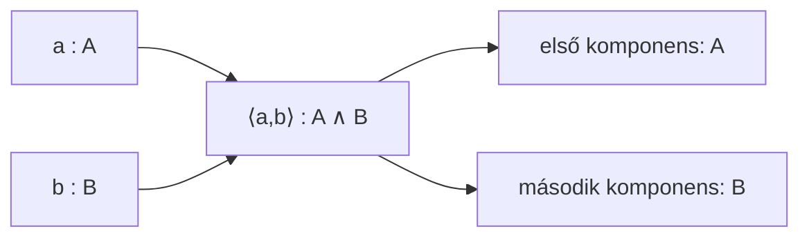
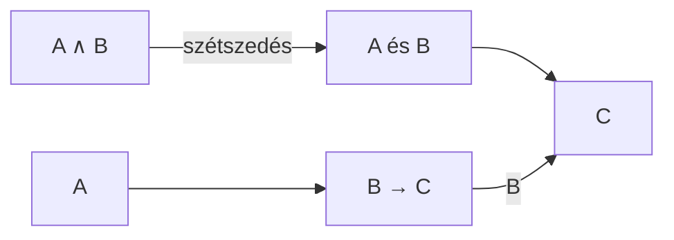

# 5. óra – Implikáció és konjunkció

A két kötőszó programozási olvasata egyszerű:

- egy `A -> B` bizonyítás olyan program, amely egy `A` bizonyításából `B` bizonyítását készíti;
- egy `A /\ B` bizonyítás egy pár: tartalmaz egy `A` és egy `B` bizonyítást.

A teljes, futtatható Coq-anyag: [`implikacio_konjunkcio.v`](implikacio_konjunkcio.v).

## Implikáció

### Szabályok

$$
\frac{[A]^i\quad\vdots\quad B}{A\to B}\;\to I\;i
\qquad
\frac{A\to B\qquad A}{B}\;\to E
$$

Az első szabályban ideiglenesen feltesszük `A`-t. Ha ebből eljutunk `B`-hez, lezárjuk a feltevést. A második szabály az implikáció alkalmazása.


Coqban a `intro` felel meg a bevezetésnek, az `apply` pedig az alkalmazásnak.

```coq
Lemma implikacio_lanc : forall A B C : Prop,
  (A -> B) -> (B -> C) -> A -> C.
Proof.
  intros A B C HAB HBC HA.
  apply HBC.
  apply HAB.
  exact HA.
Qed.
```

### Levezetési példa

$$
\frac{
  [B\to C]^2
  \qquad
  \frac{[A\to B]^1\qquad[A]^3}{B}\;\to E
}{C}\;\to E
$$

A fa olvasása belülről kifelé: `A` és `A -> B` együtt `B`-t ad; erre alkalmazzuk `B -> C`-t. A három feltevés sorban lezárható, így megkapjuk

$$
(A\to B)\to((B\to C)\to(A\to C)).
$$

## Konjunkció

### Szabályok

$$
\frac{A\qquad B}{A\land B}\;\land I
\qquad
\frac{A\land B}{A}\;\land E_1
\qquad
\frac{A\land B}{B}\;\land E_2
$$



Coqban a `split` építi fel a párt. A `destruct H as [HA HB]` szétszedi a `H : A /\ B` bizonyítást.

### Levezetési példa: a sorrend felcserélése

$$
\frac{
  \frac{[A\land B]^1}{B}\;\land E_2
  \qquad
  \frac{[A\land B]^1}{A}\;\land E_1
}{B\land A}\;\land I
$$

```coq
Lemma konjunkcio_felcserel : forall A B : Prop,
  A /\ B -> B /\ A.
Proof.
  intros A B H.
  destruct H as [HA HB].
  split.
  - exact HB.
  - exact HA.
Qed.
```

## Az implikáció és a konjunkció együtt

Az alábbi két állítás ugyanazt az adatáramlást írja le:

$$
(A\land B)\to C
\qquad\text{és}\qquad
A\to(B\to C).
$$

Az egyik program egyszerre kap egy párt, a másik előbb `A`-t, majd `B`-t kap.



## Gyakorlás

1. Bizonyítsa: `A -> B -> A`.
2. Bizonyítsa: `(A /\ B) -> (B /\ A)`.
3. Bizonyítsa: `((A /\ B) -> C) -> A -> B -> C`.
4. Bizonyítsa: `(A -> B -> C) -> (A /\ B) -> C`.

A megoldások és további példák a mellékelt Coq-fájlban vannak.
