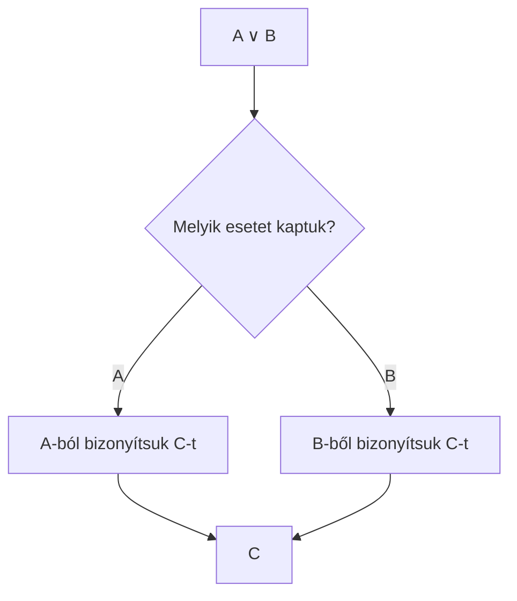
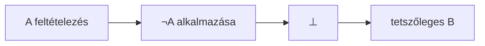
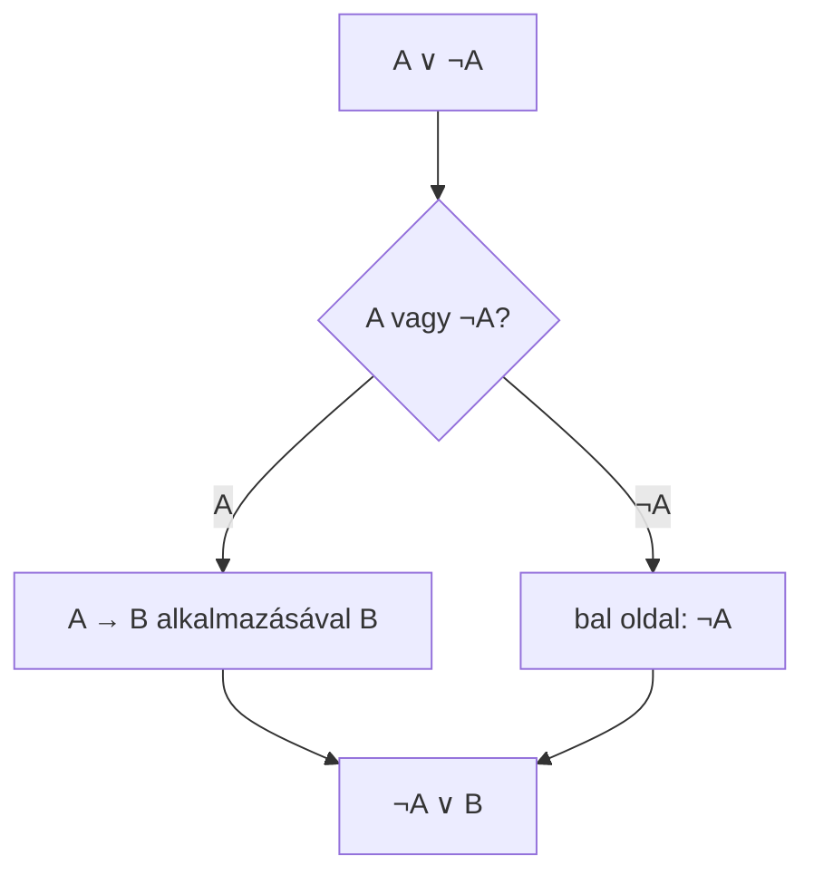

# 6. óra – Diszjunkció és negáció

Az előző órán az implikációval programokat, a konjunkcióval párokat építettünk. Most két új helyzetet kezelünk:

- `A \/ B`: két lehetőség közül tudjuk, hogy valamelyikhez van bizonyításunk;
- `~ A`: ha `A`-t feltesszük, ellentmondásra jutunk.

A teljes Coq-anyag: [`diszjunkcio_negacio.v`](diszjunkcio_negacio.v).

## Diszjunkció

### Szabályok

$$
\frac{A}{A\lor B}\;\lor I_1
\qquad
\frac{B}{A\lor B}\;\lor I_2
$$

$$
\frac{
  A\lor B
  \qquad [A]^i\;\vdots\;C
  \qquad [B]^j\;\vdots\;C
}{C}\;\lor E\;i,j
$$

A bevezetésnél megjelöljük, melyik oldalt bizonyítottuk. A felhasználásnál mindkét esetet meg kell vizsgálni, és mindkét ágból ugyanahhoz a célhoz kell eljutni.



### Levezetési példa: felcserélés

$$
\frac{
  [A\lor B]^1
  \qquad \frac{[A]^2}{B\lor A}\;\lor I_2
  \qquad \frac{[B]^3}{B\lor A}\;\lor I_1
}{B\lor A}\;\lor E\;2,3
$$

```coq
Lemma diszjunkcio_felcserel : forall A B : Prop,
  A \/ B -> B \/ A.
Proof.
  intros A B H.
  destruct H as [HA | HB].
  - right. exact HA.
  - left. exact HB.
Qed.
```

## Hamisság és negáció

`False`-nak nincs bevezetési szabálya. Ha mégis rendelkezésünkre áll, abból bármely állítás következik:

$$
\frac{\bot}{A}\;\bot E
$$

A negáció az implikáció különleges esete:

$$
\neg A \;:=\; A\to\bot.
$$



### Levezetési példa: ellentmondásból bármi

$$
\frac{
  \frac{A\to\bot\qquad A}{\bot}\;\to E
}{B}\;\bot E
$$

Coqban a `~ A` pontosan az `A -> False` rövidítése.

## De Morgan-azonosságok

Az első azonosság intuicionista logikában feltétel nélkül bizonyítható:

$$
\neg(A\lor B)\;\leftrightarrow\;(\neg A\land\neg B).
$$

A második irányhoz döntést kell tudnunk hozni legalább `A`-ról:

$$
(A\lor\neg A)\to
\bigl(\neg(A\land B)\leftrightarrow(\neg A\lor\neg B)\bigr).
$$

Ez a feltétel nem rejtett Coq-beállítás: a tétel egyik bemenete. Így a bizonyítás nem használ általános klasszikus axiómát.

## Az implikáció jellemzése

Klasszikus igazságtáblában az `A -> B` ugyanazt az igazságértéket kapja, mint `~ A \/ B`. Intuicionista logikában ehhez is szükség van arra, hogy `A` eldönthető legyen:

$$
(A\lor\neg A)\to
\bigl((A\to B)\leftrightarrow(\neg A\lor B)\bigr).
$$



## Gyakorlás

1. Bizonyítsa: `(A \/ B) -> (B \/ A)`.
2. Bizonyítsa: `~ (A \/ B) <-> (~ A /\ ~ B)`.
3. Bizonyítsa: `(A -> B) -> (~ B -> ~ A)`.
4. A `(A \/ ~ A)` feltétel felhasználásával bizonyítsa: `(A -> B) <-> (~ A \/ B)`.

A részletes megoldások a Coq-fájlban találhatók.
