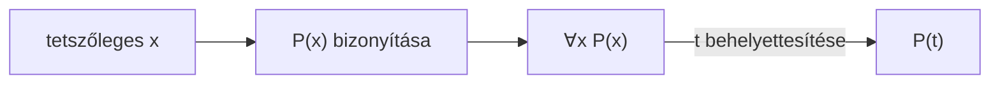
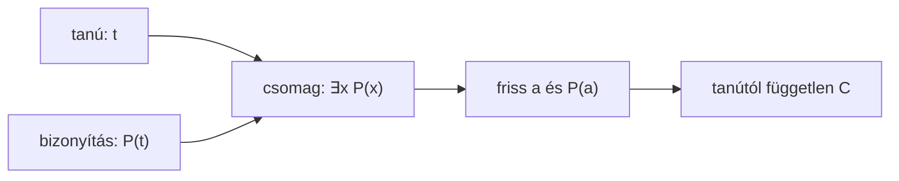
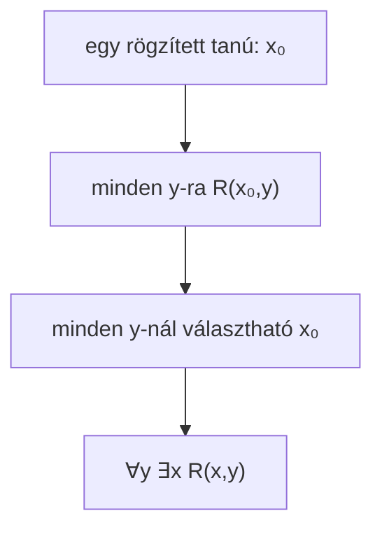

# 7. óra – A „minden” és a „létezik” kvantor

A kvantorok azt mondják meg, hogyan függ egy állítás az objektumoktól.

- `forall x, P x`: tetszőleges `x` esetén elő tudjuk állítani `P x` bizonyítását;
- `exists x, P x`: rendelkezünk egy tanúval és annak bizonyításával, hogy rá `P` teljesül.

A teljes Coq-anyag: [`kvantorok_alapok.v`](kvantorok_alapok.v).

## A „minden” kvantor

### Szabályok

$$
\frac{x\text{ tetszőleges}\quad\vdots\quad P(x)}{\forall x\,P(x)}\;\forall I
\qquad
\frac{\forall x\,P(x)}{P(t)}\;\forall E
$$

A bevezetésnél `x` valóban tetszőleges: nem támaszkodhatunk rá vonatkozó külön feltevésre. A kiküszöbölés egy konkrét `t` objektumra alkalmazza az általános állítást.



### Levezetési példa: pontonkénti alkalmazás

$$
\frac{
  \frac{\forall x(P(x)\to Q(x))}{P(y)\to Q(y)}\;\forall E
  \qquad
  \frac{\forall xP(x)}{P(y)}\;\forall E
}{Q(y)}\;\to E
$$

Mivel `y` tetszőleges, az eredményből `forall y, Q y` vezethető be.

```coq
Lemma minden_pontonként : forall (U : Type) (P Q : U -> Prop),
  (forall x, P x -> Q x) ->
  (forall x, P x) ->
  forall x, Q x.
Proof.
  intros U P Q HPQ HP x.
  apply HPQ.
  apply HP.
Qed.
```

## A „létezik” kvantor

### Szabályok

$$
\frac{P(t)}{\exists x\,P(x)}\;\exists I
$$

$$
\frac{
  \exists x\,P(x)
  \qquad [a]^i,[P(a)]^i\;\vdots\;C
}{C}\;\exists E\;i
$$

A bevezetéshez megadjuk a tanút. A felhasználáskor a tanút csak friss néven bontjuk ki; a végső `C` nem függhet attól, pontosan melyik tanút kaptuk.



### Levezetési példa: egy tulajdonság továbbadása

$$
\frac{
  \exists xP(x)
  \qquad
  \frac{
    \frac{\forall x(P(x)\to Q(x))}{P(a)\to Q(a)}\;\forall E
    \qquad P(a)
  }{Q(a)}\;\to E
}{\exists xQ(x)}\;\exists E
$$

Az ágban ugyanaz az `a` lesz az új egzisztenciális állítás tanúja.

```coq
Lemma letezik_kep : forall (U : Type) (P Q : U -> Prop),
  (forall x, P x -> Q x) ->
  (exists x, P x) ->
  exists x, Q x.
Proof.
  intros U P Q HPQ HP.
  destruct HP as [x HPx].
  exists x.
  apply HPQ.
  exact HPx.
Qed.
```

## Fontos különbség

`forall x, exists y, R x y` esetén a `y` tanú függhet `x`-től. Az `exists y, forall x, R x y` ennél erősebb: egyetlen közös tanút kér minden `x`-hez.

Az erősebb állításból következik a gyengébb:

$$
(\exists x\,\forall y\,R(x,y))
\to
(\forall y\,\exists x\,R(x,y)).
$$



A fordított irány általában nem igaz: a különböző `y` értékekhez különböző tanúk tartozhatnak.

## Gyakorlás

1. `P t` felhasználásával bizonyítsa: `exists x, P x`.
2. Bizonyítsa: `(forall x, P x -> Q x) -> (exists x, P x) -> exists x, Q x`.
3. Bizonyítsa: `(exists x, P x /\ Q x) -> exists x, P x`.
4. Bizonyítsa: `(exists x, forall y, R x y) -> forall y, exists x, R x y`.

A megoldások a Coq-fájlban találhatók.
