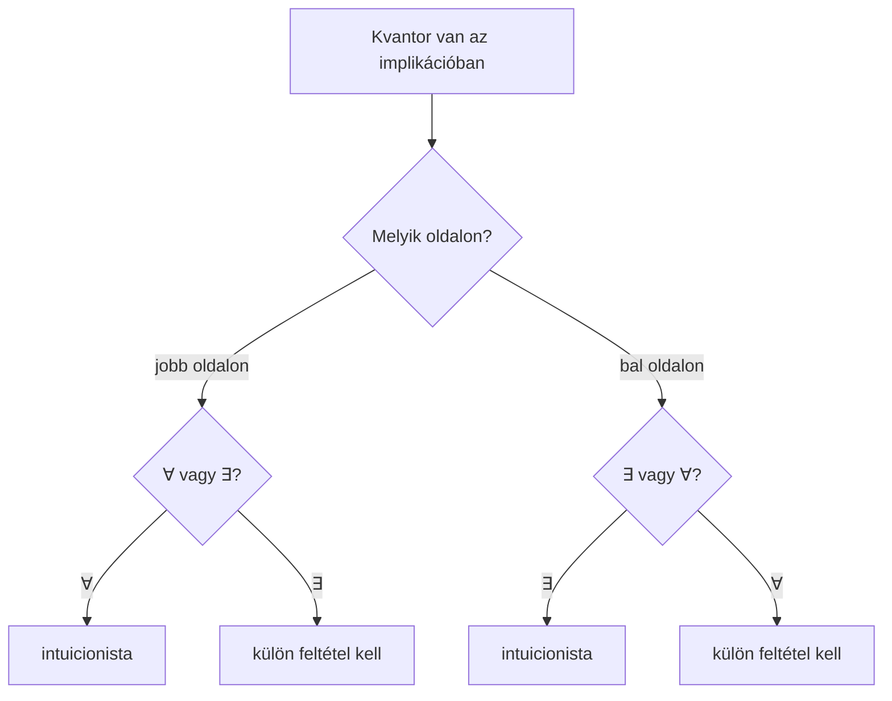

# 8. óra – Kvantorok, nehezebb feladatok és prenex alak

A **prenex alakban** minden kvantor a formula elején áll. Ezen az órán csak azt vizsgáljuk, hogyan mozgatható egy kvantor az implikáció két oldaláról a formula elejére.

A teljes Coq-anyag: [`prenex_implikacio.v`](prenex_implikacio.v).

Az alábbi formulákban `B` nem függ `x`-től. Coqban ezt úgy írjuk le, hogy `B : Prop`, míg `A : U -> Prop`.

## Először két nehezebb kvantoros példa

### A nemlétezés átírása

Ez az azonosság intuicionista logikában is igaz:

$$
\neg\exists x\,A(x)
\quad\leftrightarrow\quad
\forall x\,\neg A(x).
$$

Balról jobbra: ha egy adott `x`-re mégis lenne `A(x)`, akkor ezzel tanút adnánk a tiltott egzisztenciális állításhoz. Jobbról balra: egy egzisztenciális tanút kibontva rögtön alkalmazható rá az általános tagadás.

### Egy közös tanú használata

$$
(\exists x\,\forall y\,R(x,y))
\to
(\forall y\,\exists x\,R(x,y)).
$$

Az egzisztenciális állításból kapott egyetlen tanút minden `y` esetén újra felhasználjuk. A fordított irány általában nem igaz.

## A négy implikációs eset



| Kiinduló alak | Kvantor elöl | Mikor bizonyítható mindkét irány? |
|---|---|---|
| `B -> forall x, A x` | `forall x, B -> A x` | intuicionista logikában |
| `(exists x, A x) -> B` | `forall x, A x -> B` | intuicionista logikában |
| `B -> exists x, A x` | `exists x, B -> A x` | nem üres alaphalmaz és `B \/ ~B` mellett |
| `(forall x, A x) -> B` | `exists x, A x -> B` | nem üres alaphalmaz és az általános állítás vagy egy ellenpélda rendelkezésre állása mellett |

## 1. Univerzális kvantor az implikáció jobb oldalán

$$
(B\to\forall x\,A(x))
\quad\leftrightarrow\quad
\forall x\,(B\to A(x)).
$$

Mindkét irány intuicionista. Egy tetszőleges `x` mellett ugyanazt a `B` bizonyítást használjuk.

$$
\frac{
  [B\to\forall xA(x)]^1\qquad[B]^2
}{
  \frac{\forall xA(x)}{A(a)}\;\forall E
}\;\to E
$$

## 2. Egzisztenciális kvantor az implikáció bal oldalán

$$
((\exists x\,A(x))\to B)
\quad\leftrightarrow\quad
\forall x\,(A(x)\to B).
$$

Ez is mindkét irányban intuicionista. Az egyik irányban `A(a)`-ból bevezetjük `exists x, A x`-et. A másik irányban kibontjuk az egzisztenciális tanút, majd rá alkalmazzuk az általános implikációt.


## 3. Egzisztenciális kvantor az implikáció jobb oldalán

$$
(B\to\exists x\,A(x))
\quad\leftrightarrow\quad
\exists x\,(B\to A(x)).
$$

Jobbról balra nincs gond: a már megadott tanút használjuk. Balról jobbra viszont akkor is ki kell választanunk egy tanút, amikor `B` hamis. Ehhez két feltételt teszünk a tételbe:

1. az alaphalmaz nem üres: `exists x : U, True`;
2. `B` eldönthető: `B \/ ~ B`.

Ha `B` igaz, a kiinduló program ad tanút. Ha `B` hamis, az alaphalmaz tetszőleges elemét választjuk, és a `B -> A x` implikáció hamis előtag miatt bizonyítható.

## 4. Univerzális kvantor az implikáció bal oldalán

$$
((\forall x\,A(x))\to B)
\quad\leftrightarrow\quad
\exists x\,(A(x)\to B).
$$

Jobbról balra ismét intuicionista: az általános feltevést a megadott tanúra alkalmazzuk. A másik irányban tanút kell választani. A tételben ezért szerepel:

1. `exists x : U, True`;
2. `(forall x, A x) \/ exists x, ~ A x`.

Az első esetben az alaphalmaz egy tetszőleges elemét választjuk, és a kiinduló implikációval bizonyítjuk `B`-t. A második esetben az ellenpéldát választjuk; az `A x -> B` állítás az `A x` és `~ A x` ellentmondásából következik.

## Miért így jelenik meg a klasszikus lépés Coqban?

Nem töltünk be klasszikus Coq-könyvtárat, és nem kapcsolunk be rejtett axiómát. A szükséges döntési állítások a tételek bemenetei:

```coq
Theorem prenex_letezik_jobbra :
  forall (U : Type) (A : U -> Prop) (B : Prop),
    (exists x : U, True) ->
    (B \/ ~ B) ->
    ((B -> exists x, A x) <-> exists x, B -> A x).
```

Így pontosan látszik, melyik lépés intuicionista, és melyikhez kell további feltétel.

## Gyakorlás

1. Bizonyítsa: `(~ exists x, A x) <-> forall x, ~ A x`.
2. Bizonyítsa feltétel nélkül a fenti 1. és 2. prenex azonosságot.
3. A megadott két feltétellel bizonyítsa a 3. azonosságot.
4. A megadott két feltétellel bizonyítsa a 4. azonosságot.

A megoldások a Coq-fájlban találhatók. A következő, `9` könyvtárban ezek gyakorló változatai következnek.
